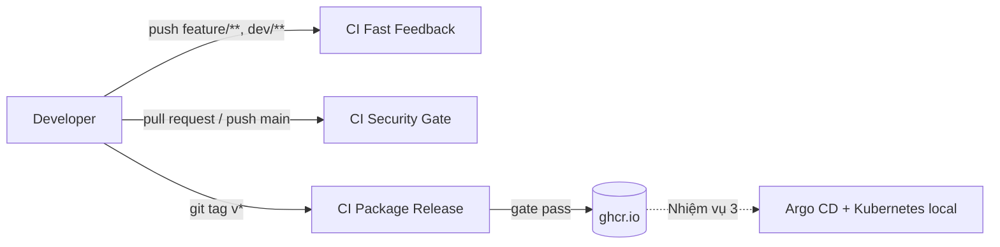

# shop-devsecops

[](https://github.com/dang170806/shop-devsecops/actions/workflows/ci-fast-feedback.yml)
[](https://github.com/dang170806/shop-devsecops/actions/workflows/ci-security-gate.yml)
[](https://github.com/dang170806/shop-devsecops/actions/workflows/ci-packaging-release.yml)

Pipeline CI/CD tích hợp kiểm tra bảo mật tự động (DevSecOps) cho một ứng dụng web Spring Boot, đóng gói bằng Docker và phát hành lên GitHub Container Registry. Đây là đồ án Project 1, trọng tâm là **pipeline và bảo mật chuỗi cung ứng**, không phải nghiệp vụ của ứng dụng.

> **Về ứng dụng:** phần code Java được tái sử dụng từ một template quản lý bất động sản (package `com.devon.building`, entity `Building`, `Customer`, `Transaction`) và được dùng làm ứng dụng mẫu để chạy pipeline. Phần có giá trị của repo nằm ở `Dockerfile`, `compose.yaml` và thư mục `.github/`.

## Mục lục

1. [Tổng quan kiến trúc](#tổng-quan-kiến-trúc)
2. [Công nghệ sử dụng](#công-nghệ-sử-dụng)
3. [Chạy ứng dụng ở máy local](#chạy-ứng-dụng-ở-máy-local)
4. [Biến môi trường](#biến-môi-trường)
5. [Docker image](#docker-image)
6. [Kiểm thử](#kiểm-thử)
7. [Pipeline CI/CD](#pipeline-cicd)
8. [Security gate và mô hình chấm điểm rủi ro](#security-gate-và-mô-hình-chấm-điểm-rủi-ro)
9. [Quy trình phát hành](#quy-trình-phát-hành)
10. [Biện pháp bảo mật chuỗi cung ứng](#biện-pháp-bảo-mật-chuỗi-cung-ứng)
11. [Cấu trúc thư mục](#cấu-trúc-thư-mục)
12. [Lộ trình](#lộ-trình)
13. [Xử lý sự cố thường gặp](#xử-lý-sự-cố-thường-gặp)

## Tổng quan kiến trúc



Ba workflow tách theo thời điểm kích hoạt: phản hồi nhanh khi đang code, kiểm tra bảo mật đầy đủ trước khi vào `main`, và đóng gói phát hành khi gắn tag. Image chỉ được đẩy lên registry khi toàn bộ test và security gate đã qua.

## Công nghệ sử dụng

| Thành phần | Công nghệ |
|---|---|
| Ứng dụng | Java 17, Spring Boot 4.0.x, Spring Data JPA, Spring Security (OAuth2 Google/GitHub), Thymeleaf |
| Cơ sở dữ liệu | MySQL 8.4 (chạy bằng Docker Compose) |
| Build | Maven (Maven Wrapper `mvnw`) |
| Container | Docker, Docker Compose |
| CI/CD | GitHub Actions |
| Lint Dockerfile | Hadolint |
| Quét lỗ hổng image | Trivy |
| Test | JUnit 5, Mockito, Spring MockMvc, Testcontainers |
| Registry | GitHub Container Registry (`ghcr.io`) |
| Cập nhật phụ thuộc | Dependabot (GitHub Actions và Docker) |

## Chạy ứng dụng ở máy local

**Yêu cầu:** Docker (đang chạy), JDK 17. Không cần cài Maven vì đã có `mvnw`.

Dockerfile chỉ copy file `target/app.jar` có sẵn, nên **phải build JAR trước khi build image**.

```powershell
# 1. Tạo file cấu hình từ mẫu rồi điền giá trị
Copy-Item .env.example .env

# 2. Build JAR (bỏ qua test cho nhanh)
.\mvnw package -DskipTests

# 3. Build image và chạy cả ứng dụng lẫn MySQL
docker compose up --build
```

Trên Linux/macOS dùng `cp .env.example .env` và `./mvnw`.

Ứng dụng chạy tại `http://localhost:9095`. Dừng và dọn dẹp:

```powershell
docker compose down        # giữ lại dữ liệu MySQL
docker compose down -v     # xoá cả volume, lần chạy sau nạp lại backupdb.sql
```

Dữ liệu ban đầu lấy từ `backupdb.sql`, chỉ được nạp **một lần** khi volume còn trống. Muốn nạp lại thì phải dùng `down -v`.

## Biến môi trường

Sao chép `.env.example` thành `.env` (file này đã nằm trong `.gitignore` và `.dockerignore`, không bao giờ commit).

| Biến | Bắt buộc | Mô tả |
|---|---|---|
| `APP_PORT` | Không | Cổng công bố ra máy host, mặc định `9095` |
| `DB_NAME` | Có | Tên database |
| `DB_USER` | Có | User ứng dụng của MySQL, **không được đặt là `root`** |
| `DB_PASSWORD` | Có | Mật khẩu của `DB_USER` |
| `DB_ROOT_PASSWORD` | Có | Mật khẩu root của MySQL, nên khác `DB_PASSWORD` |
| `GOOGLE_CLIENT_ID`, `GOOGLE_CLIENT_SECRET` | Để đăng nhập Google | Tạo OAuth client ở Google Cloud Console |
| `GITHUB_CLIENT_ID`, `GITHUB_CLIENT_SECRET` | Để đăng nhập GitHub | Tạo OAuth App ở GitHub Developer settings |

Redirect URI khi tạo OAuth client: `http://localhost:9095/login/oauth2/code/google` và `http://localhost:9095/login/oauth2/code/github`.

Compose dùng cú pháp `${BIEN:?thông báo}` cho các biến bắt buộc, nên thiếu biến sẽ báo lỗi rõ ràng ngay khi chạy.

## Docker image

`Dockerfile` chỉ có một stage chạy, JAR được build trước ở bước Maven:

```dockerfile
FROM eclipse-temurin:17-jre-alpine-3.24@sha256:...   # ghim theo digest
RUN addgroup -S app && adduser -S app -G app
COPY --chown=app:app target/app.jar /app/app.jar
USER app                                              # không chạy bằng root
ENTRYPOINT ["java", "-XX:MaxRAMPercentage=75", "-jar", "/app/app.jar"]
```

Các quyết định thiết kế:

- **Chạy bằng user không phải root.** Cần thiết khi triển khai lên Kubernetes với `runAsNonRoot`.
- **Ghim base image theo digest.** Kết quả quét Trivy ổn định giữa các lần chạy; Dependabot sẽ đề xuất cập nhật digest định kỳ.
- **Image chạy là JRE alpine**, không chứa Maven hay source, nên nhỏ và ít lỗ hổng hơn.
- **JAR trong image chính là JAR đã qua test.** Trong CI, `mvnw verify` chạy xong mới build image, nên image không được build từ thứ chưa kiểm thử.
- `.dockerignore` loại `.git`, `.env*`, `*.sql` và `target/` (trừ `target/app.jar`) khỏi build context.
- `-XX:MaxRAMPercentage=75` để JVM tôn trọng giới hạn bộ nhớ của container.

## Kiểm thử

| Loại | Quy ước tên | Công cụ chạy | Ghi chú |
|---|---|---|---|
| Unit test | `*Test`, `*Tests` | Surefire (`mvnw test`) | Mockito, không chạm database thật |
| Integration test | `*IT` | Failsafe (`mvnw verify`) | MockMvc và MySQL thật qua Testcontainers |

Các integration test kế thừa `IntegrationTestBase`, lớp này khởi động một container `mysql:8.0` dùng chung cho cả lần chạy test. Các test kiểm tra phân quyền theo vai trò (MANAGER, STAFF, USER) trên các API quản trị.

```powershell
.\mvnw test      # unit test
.\mvnw verify    # unit test + integration test (đầy đủ, giống CI)
```

**Lưu ý:** Docker phải đang chạy cho cả hai lệnh, vì lớp `SpringShoppingCart2ApplicationTests` cũng dùng Testcontainers và Surefire sẽ chạy nó. Muốn chạy riêng các unit test thuần:

```powershell
.\mvnw test "-Dtest=*ServiceImplTest,ContactRequestValidationTest"
```

Chạy riêng một class integration test:

```powershell
.\mvnw verify "-Dit.test=BuildingAPIIntegrationTestIT"
```

## Pipeline CI/CD

Ba workflow trong `.github/workflows/`:

| Workflow | Kích hoạt | Các bước chính | Mục đích |
|---|---|---|---|
| **CI Fast Feedback** | Push `feature/**`, `dev/**`; PR vào `main`, `dev`; chạy tay. Chỉ khi file liên quan thay đổi (`src`, `pom.xml`, `Dockerfile`, `compose.yaml`, `.github`...) | Hadolint, build JAR, build image, kiểm tra `compose.yaml` | Báo lỗi nhanh khi đang code |
| **CI Security Gate** | PR vào `main`; push `main`; chạy tay | `mvnw verify`, build image, quét Trivy, tính điểm rủi ro, chặn nếu vượt ngưỡng | Cổng bảo mật trước khi vào `main` |
| **CI Package Release** | Push tag `v*`; chạy tay | `mvnw verify`, build image, quét Trivy, security gate, upload JAR, đẩy image lên `ghcr.io` | Phát hành |

Chi tiết đáng chú ý:

- Hadolint ở mức `failure-threshold: error`, chỉ chặn khi có lỗi mức error.
- Báo cáo Trivy (`trivy-result.json`) được upload thành artifact (giữ 14 ngày) kể cả khi gate fail, để xem lại chi tiết.
- Bảng tóm tắt từng lần chạy nằm ở tab **Summary** của run trên GitHub Actions.
- Đẩy image chỉ xảy ra khi chạy từ tag `v*`, **sau** security gate. Chạy tay không đẩy image.
- `concurrency` tránh chạy trùng: Fast Feedback và Security Gate huỷ lần chạy cũ khi có commit mới, Release thì không huỷ.

## Security gate và mô hình chấm điểm rủi ro

Mã nguồn trong `.github/scripts/`:

- `calculate_risk.sh` đếm lỗ hổng từ kết quả Trivy, tính điểm và ghi bảng tóm tắt.
- `enforce_security_gate.sh` đọc điểm và quyết định pass hoặc fail.

**Công thức:**

```text
Risk Score = 10 × Critical + 5 × High + 1 × Medium
```

**Gate FAIL khi:**

- có ít nhất 1 lỗ hổng `CRITICAL`, hoặc
- `Risk Score ≥ RISK_SCORE_THRESHOLD` (mặc định `10`, đặt ở khối `env` của workflow), hoặc
- test, build image hoặc quét Trivy không thành công.

Ví dụ minh hoạ cách tính (không phải kết quả quét thật):

| Critical | High | Medium | Score | Kết quả |
|---|---|---|---|---|
| 0 | 0 | 3 | 3 | PASS |
| 0 | 1 | 4 | 9 | PASS |
| 0 | 2 | 0 | 10 | FAIL |
| 1 | 0 | 0 | 10 | FAIL |

**Fail-closed:** thiếu file kết quả, JSON sai định dạng hoặc không đếm được lỗ hổng đều coi là `999` điểm và FAIL. Cổng không bao giờ pass chỉ vì quét lỗi. Đây là bài học từ một bản nháp đầu của script: lệnh `|| echo 0` che lỗi của `jq` làm gate luôn pass dù không đọc được kết quả.

## Quy trình phát hành

```powershell
git checkout main
git pull
git tag -a v0.0.1 -m "Mô tả ngắn về bản phát hành"
git push origin v0.0.1
```

Workflow **CI Package Release** chạy, và nếu gate pass thì image được đẩy lên registry với hai tag:

- `ghcr.io/dang170806/shop-devsecops:v0.0.1` (theo phiên bản)
- `ghcr.io/dang170806/shop-devsecops:sha-<7 ký tự đầu của commit>` (truy vết theo commit)

Image đẩy lên chính là image đã được Trivy quét, không build lại. Không dùng tag `latest`. Mỗi bản phát hành dùng số phiên bản mới (`v0.0.2`...), không dùng lại tag cũ.

Kéo image về chạy thử (sau khi package được đặt ở chế độ Public hoặc đã `docker login ghcr.io`):

```powershell
docker pull ghcr.io/dang170806/shop-devsecops:v0.0.1
```

## Biện pháp bảo mật chuỗi cung ứng

- **GitHub Actions ghim theo commit SHA**, kèm comment phiên bản; Dependabot cập nhật hằng tuần.
- **Base image và image MySQL ghim theo digest.**
- **Quyền tối thiểu:** workflow mặc định `contents: read`; riêng job phát hành thêm `packages: write`.
- `persist-credentials: false` ở bước checkout, token không còn lưu trong git config sau khi checkout.
- **Không có secret trong repo.** Thông tin nhạy cảm đọc từ biến môi trường; `.env*` bị `.gitignore` và `.dockerignore` loại. CI dùng giá trị giả (`ci-test-secret`).
- **Container không chạy bằng root.**
- **Đẩy registry bằng `GITHUB_TOKEN`** có thời hạn ngắn, không cần tạo token dài hạn.
- Cổng 3306 của MySQL không được công bố ra máy host, chỉ ứng dụng trong mạng Compose truy cập được.

## Cấu trúc thư mục

```text
.
├── .github/
│   ├── dependabot.yml                  # cập nhật GitHub Actions và Docker
│   ├── scripts/
│   │   ├── calculate_risk.sh           # tính Risk Score từ kết quả Trivy
│   │   └── enforce_security_gate.sh    # quyết định pass/fail của gate
│   └── workflows/
│       ├── ci-fast-feedback.yml
│       ├── ci-security-gate.yml
│       └── ci-packaging-release.yml
├── src/                                # mã nguồn Java và test
├── Dockerfile
├── compose.yaml                        # ứng dụng + MySQL
├── backupdb.sql                        # dữ liệu khởi tạo
├── .env.example                        # mẫu biến môi trường
├── .dockerignore
├── mvnw, mvnw.cmd, .mvn/               # Maven Wrapper
└── pom.xml
```

## Lộ trình

- [x] **Nhiệm vụ 1:** ứng dụng và Docker (Dockerfile, Compose, xử lý secret bị lộ)
- [x] **Nhiệm vụ 2:** CI pipeline, test, Hadolint, Trivy, security gate, phát hành image lên `ghcr.io`
- [ ] **Nhiệm vụ 3:** Kubernetes local (kind/minikube), Helm chart, Argo CD (GitOps)
- [ ] **Nhiệm vụ 4:** tích hợp kube-bench, hoàn thiện báo cáo bảo mật tổng hợp
- [ ] **Nhiệm vụ 5:** giám sát (Prometheus, Grafana) và bài tập mô phỏng sự cố (failure drill)

## Xử lý sự cố thường gặp

| Triệu chứng | Nguyên nhân và cách xử lý |
|---|---|
| `docker build` báo không tìm thấy `target/app.jar` | Chưa build JAR. Chạy `.\mvnw package -DskipTests` trước. |
| `Could not find a valid Docker environment` khi chạy test | Docker chưa chạy. Bật Docker Desktop, kiểm tra bằng `docker info`. |
| `docker compose` báo `Set DB_NAME in .env` | Chưa tạo `.env` hoặc thiếu biến bắt buộc. Xem [Biến môi trường](#biến-môi-trường). |
| MySQL báo lỗi về `MYSQL_USER` ngay khi khởi động | `DB_USER` đang đặt là `root`. Đổi sang tên khác, ví dụ `shop_app`. |
| Sửa `backupdb.sql` nhưng dữ liệu không đổi | Script khởi tạo chỉ chạy khi volume trống. Dùng `docker compose down -v`. |
| Ứng dụng không khởi động vì cấu hình OAuth | Điền giá trị tạm cho `GOOGLE_CLIENT_ID/SECRET` và `GITHUB_CLIENT_ID/SECRET` trong `.env`. Đăng nhập OAuth chỉ hoạt động khi dùng giá trị thật. |
| Gate FAIL với Risk Score cao | Mở artifact `trivy-results-*` để xem lỗ hổng. Hướng xử lý: cập nhật base image, nâng thư viện, hoặc cân nhắc điều chỉnh `RISK_SCORE_THRESHOLD`. |
| Push tag nhưng workflow Release không chạy | Tag phải bắt đầu bằng `v` và commit được gắn tag phải đã chứa file workflow hợp lệ. Kiểm tra tab Actions xem có báo `Invalid workflow file` không. |
| `Permission denied` khi chạy `./mvnw` trên Linux | File thiếu quyền thực thi. Chạy `git update-index --chmod=+x mvnw` rồi commit. |
